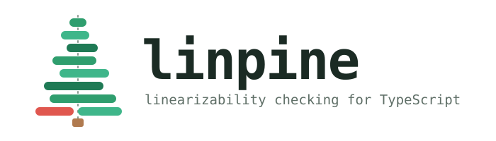
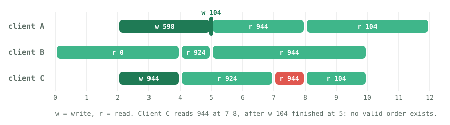

<p align="center">
  
</p>

<p align="center">
  <a href="https://github.com/aiagui/linpine/actions/workflows/ci.yml"></a>
  <a href="LICENSE"></a>
  = 22.13">
</p>

linpine tells you whether a history of concurrent operations could have happened on a
correct, sequential version of your system. You record what each client called, when it
started and when it got an answer; linpine searches for an order that explains every result.
If none exists, it says so and shows how far it got.

It is a small TypeScript library with no runtime dependencies, meant for tests of caches,
locks, queues and clients of distributed stores.

## Usage

```ts
import { check, register } from "linpine";

const history = [
  { call: 0, ret: 2, input: { op: "write", value: 1 } },
  { call: 3, ret: 4, input: { op: "read" }, output: 0 }, // stale
] as const;

const r = check(register(0), history, { timeoutMs: 1000 });
// { result: "illegal", partition: 0, longest: [0], steps: 4 }
```

`result` is `"ok"`, `"illegal"` or `"unknown"` (the step or time budget ran out).
An operation without `ret` is treated as still pending. `kv()` checks each key on its own.

Install it from GitHub:

```sh
npm install github:aiagui/linpine
```

## Demo

A store with a read cache that is refreshed just after the write is acknowledged. Three
clients run five operations each on a seeded virtual clock, so every seed replays the same
history. In about 8% of seeds a client reads a value that was already overwritten.

<p align="center">
  
</p>

<p align="center">
  
</p>

```sh
npm run demo            # buggy cache, 1000 seeds
npm run demo -- --fixed # same seeds, no violations
```

Set `NO_COLOR=1` for plain output. The timeline is drawn from the real seed-1 history with `npm run docs:history`.

## How it works

linpine uses the search from Wing and Gong with the memoisation described by Gavin Lowe,
the same approach as [Porcupine](https://github.com/anishathalye/porcupine) (Go) and
[Knossos](https://github.com/jepsen-io/knossos) (Clojure). Calls and returns go into one
ordered list. The checker repeatedly picks an operation that could take effect now, applies
it to your model and moves on, backtracking when a result can't be explained. Visited
(set of operations, model state) pairs are cached, so the same dead end is never explored twice.

A model is three functions:

```ts
interface Model<S, I, O> {
  init: S;
  step(state: S, input: I, output: O | undefined): readonly [ok: boolean, next: S];
  key(state: S): string;                 // identifies a state for the cache
  partition?(history): Operation[][];    // optional: split into independent parts
}
```

When a return and a call share a timestamp they are treated as overlapping, as in Porcupine.
Pass `strictTies: true` to treat them as ordered.

## Limits

- Checking linearizability is NP-complete. Many concurrent writes of the same key blow up:
  18 overlapping writes followed by an impossible read take around 16 s without a budget.
  Always set `timeoutMs` or `maxSteps` in tests.
- The check runs synchronously and blocks the event loop until it finishes or hits its budget.
- Timestamps must come from one clock. For several processes, use a shared or virtual clock,
  or widen the intervals.
- `longest` lists the operations that fit in a valid order before the search got stuck. It can
  be empty, for example when the very first operation already returns an impossible value.
- linpine checks a history you give it. It does not generate workloads or inject faults.

## License

[MIT](LICENSE) © Aitor Aguilar
